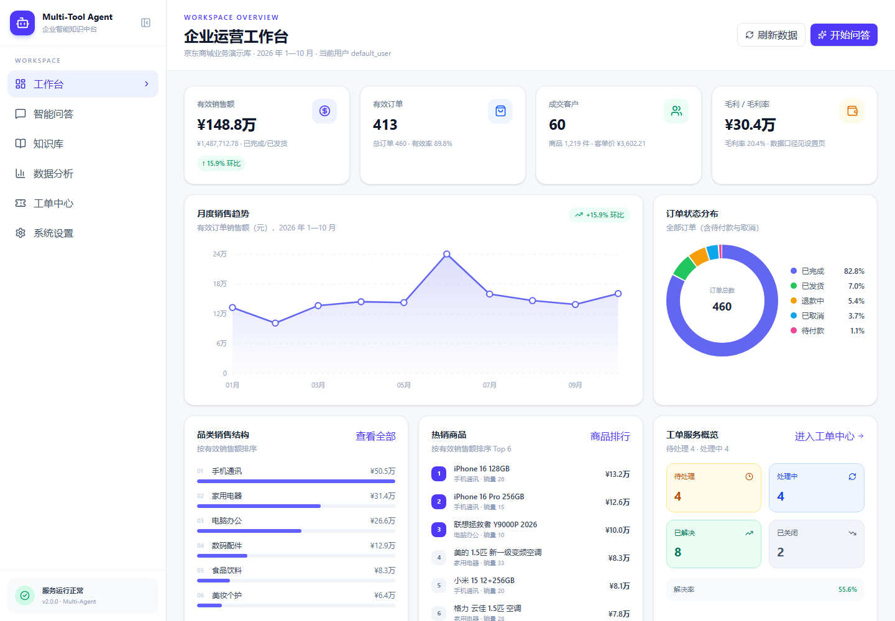

# Multi-Tool Agent · 企业智能知识中台

基于 **LangGraph + FastAPI + React** 的企业级多 Agent 协作系统，面向企业内部知识问答、业务数据分析与工单管理场景。系统以 Supervisor 为统一入口，根据用户意图调度 RAG、Text-to-SQL 与 Ticket Agent，并提供完整的可视化工作台。

> 企业场景：京东集团员工手册知识库 + 京东商城业务演示数据 + 企业内部服务工单。



## 核心能力

| 模块 | 能力 |
|---|---|
| **Supervisor** | 问题补全、意图路由、失败重试、Trace ID 调用追踪 |
| **RAG Agent** | PDF 解析、BM25 + 向量混合检索、RRF 融合、CrossEncoder 精排、页码引用、引用校验 |
| **Text-to-SQL Agent** | 真实 Schema 读取、SQL 生成、只读执行、错误自动修正、自然语言结论 |
| **Ticket Agent** | 工单创建、列表查询、单张状态查询、关闭工单、按 `user_id` 数据隔离 |
| **数据分析** | 销售额 / 订单 / 客单价 / 毛利 / 品类 / 城市 / 事业部 / 渠道 / 状态多维分析 |
| **知识库管理** | 文档列表、PDF 上传、切片索引、语义检索、删除、重建索引 |
| **多轮记忆** | 按 `session_id` 保存历史，支持上下文追问补全 |
| **前端工作台** | 工作台、智能问答、知识库、数据分析、工单中心、系统设置六个页面 |
| **可观测性** | 请求 Trace ID、执行步骤、SQL 展示、检索来源、组件健康检查 |

## 多 Agent 架构

```text
用户请求
   │
   ▼
Supervisor Agent
   ├── 问题补全（结合 session 历史）
   ├── 意图路由
   │      ├── RAG Agent ──► 混合检索 ──► Reranker ──► 引用校验
   │      ├── SQL Agent ──► Schema ──► SQL ──► 只读执行 ──► 结论
   │      └── Ticket Agent ──► 意图解析 ──► 工单读写 ──► 用户隔离
   ▼
统一返回：answer / tool_used / sources / data / trace_steps / trace_id
```

RAG 处理链路：

```text
PDF → 文本提取 → 500 字切片（重叠 80）→ BGE 向量 + BM25
    → RRF 融合 → bge-reranker 精排 → Top-K → LLM 生成 → 页码引用校验
```

## 技术栈

- **后端**：Python 3.11+、FastAPI、Uvicorn、Pydantic
- **Agent 编排**：LangGraph
- **模型服务**：DeepSeek `deepseek-chat`
- **检索**：ChromaDB、`BAAI/bge-small-zh-v1.5`、`BAAI/bge-reranker-base`、BM25、RRF
- **数据存储**：SQLite（业务库 / 工单库 / 会话记忆库 / 知识库登记）
- **前端**：React 19、Vite 8、Tailwind CSS 4、Lucide 图标、原生 SVG 图表
- **部署**：Docker 多阶段构建，FastAPI 直接托管前端 `dist`

## 数据说明

业务数据围绕京东商城场景构造，包含 6 个事业部、12 名销售员工、60 位客户、45 个商品、460 笔订单、828 条明细，以及 1 条京东集团 2025 年公开业绩；工单库包含 18 张企业内部服务工单。知识库为 51 页《京东集团员工手册》。

数据来源、商品参考价、模拟生成方式和统计口径详见 [DATA_SOURCES.md](DATA_SOURCES.md)。

> 客户、员工、订单为固定随机种子生成的演示数据，不对应真实个人或真实交易；商品参考价仅用于演示，不是实时价格。

## 目录结构

```text
Multi-Tool-Agent/
├── server.py                 # FastAPI 入口：对话 / 分析 / 知识库 / 工单 / 会话 API
├── supervisor_agent.py       # Supervisor 多 Agent LangGraph
├── agent_rag_v2.py           # RAG Agent（检索、生成、引用校验）
├── text2sql.py               # Text-to-SQL Agent（生成、校验、执行、修正）
├── ticket_agent.py           # 工单意图解析与执行
├── ticket_tools.py           # 工单数据访问层
├── knowledge_base.py         # PDF 索引、Chroma 持久化、文档管理
├── hybrid_retriever.py       # BM25 + Vector + RRF + Reranker
├── analytics.py              # 业务分析聚合查询
├── database.py               # SQLite 访问、Schema、只读执行
├── sql_validator.py          # SQL 安全校验
├── conversation_memory.py    # 多轮会话记忆
├── seed_business_data.py     # 业务库 / 工单库种子数据
├── init_db.py                # 数据库初始化入口
├── evaluate.py               # 端到端评估脚本
├── eval_set.json             # 15 题评估集
├── requirements.txt
├── Dockerfile
├── frontend/                 # React 工作台
│   ├── src/pages/            # 工作台、问答、知识库、分析、工单、设置
│   ├── src/components/       # 布局、图表、表格、Markdown、UI
│   └── src/lib/              # API 客户端与格式化工具
├── knowledge/                # PDF 文档（运行时生成）
├── chroma_db/                # 向量索引（运行时生成）
├── business.db               # 业务库（运行时生成）
├── tickets.db                # 工单库（运行时生成）
├── conversation_memory.db    # 会话记忆（运行时生成）
└── screenshots/              # 页面截图
```

## 快速开始

### 1. 环境准备

建议 Python 3.11+，Node.js 20+（前端构建）。

```bash
python -m venv .venv
# Windows
.venv\Scripts\activate
# macOS / Linux
source .venv/bin/activate

pip install -r requirements.txt
```

模型首次运行会从 HuggingFace 镜像下载并缓存；也可以提前下载：

```bash
python -c "from sentence_transformers import SentenceTransformer, CrossEncoder; \
SentenceTransformer('BAAI/bge-small-zh-v1.5'); CrossEncoder('BAAI/bge-reranker-base')"
```

### 2. 配置环境变量

复制 `.env.example` 为 `.env`，填入 DeepSeek API Key：

```dotenv
DEEPSEEK_API_KEY=sk-your-key
DEEPSEEK_BASE_URL=https://api.deepseek.com
DEEPSEEK_MODEL=deepseek-chat
PORT=8000
```

`.env` 已被 `.gitignore` 忽略，请勿提交真实 Key。

### 3. 初始化数据

首次启动会自动生成 `business.db`、`tickets.db` 与知识库索引；也可以手动执行：

```bash
python init_db.py
```

该命令会重建演示业务库与工单库（固定种子，结果可重复）。

### 4. 启动后端

```bash
uvicorn server:app --host 127.0.0.1 --port 8000
```

首次启动会加载 Embedding / Reranker 模型并索引 PDF，通常需要 20—60 秒。
看到以下日志即表示就绪：

```text
[Knowledge] 就绪：1 个文档，154 个切片
服务启动完成：知识库=ready，检索器=ready
```

### 5. 启动前端

开发模式（Vite 代理到 8000 端口）：

```bash
cd frontend
npm install
npm run dev
```

访问 [http://127.0.0.1:5173](http://127.0.0.1:5173)。

生产模式（由 FastAPI 直接托管）：

```bash
cd frontend
npm run build
```

然后访问 [http://127.0.0.1:8000](http://127.0.0.1:8000)。

### 6. 常用入口

| 地址 | 说明 |
|---|---|
| `http://127.0.0.1:8000/` | 前端工作台 |
| `http://127.0.0.1:8000/docs` | Swagger API 文档 |
| `http://127.0.0.1:8000/api/health` | 组件健康检查 |
| `http://127.0.0.1:8000/ask/supervisor` | 多 Agent 对话接口 |

## Docker

```bash
docker build -t multi-tool-agent .
docker run --rm -p 8000:8000 --env-file .env multi-tool-agent
```

镜像内包含前端构建产物与预下载的 Embedding / Reranker 模型，启动后访问 `http://127.0.0.1:8000`。

> 演示数据与知识库索引在容器内生成；如需持久化，可将 `business.db`、`tickets.db`、`conversation_memory.db`、`knowledge/`、`chroma_db/` 挂载为卷。

## API 一览

| 方法 | 路径 | 说明 |
|---|---|---|
| POST | `/ask/supervisor` | 主入口：Supervisor 多 Agent 对话 |
| POST | `/ask/rag` | 直接测试混合检索 |
| POST | `/ask/data` | 直接测试 Text-to-SQL |
| POST | `/debug/route` | 查看意图路由结果 |
| GET | `/api/health` | 组件健康状态 |
| GET | `/api/dashboard` | 工作台聚合数据 |
| GET | `/api/analytics/overview` | 销售额 / 订单 / 客单价 / 毛利 |
| GET | `/api/analytics/trend` | 月度趋势 |
| GET | `/api/analytics/categories` | 品类结构 |
| GET | `/api/analytics/top-products` | 商品排行（销售额 / 销量） |
| GET | `/api/analytics/cities` | 城市分布 |
| GET | `/api/analytics/departments` | 事业部业绩 |
| GET | `/api/analytics/order-status` | 订单状态分布 |
| GET | `/api/orders` | 订单分页 / 搜索 / 筛选 |
| GET | `/api/products` | 商品列表 |
| POST | `/api/sql/query` | 自然语言问数，返回答案 + SQL + 表格 |
| GET | `/api/knowledge/stats` | 知识库统计 |
| GET | `/api/knowledge/documents` | 文档列表 |
| POST | `/api/knowledge/documents` | 上传 PDF 并建立索引 |
| DELETE | `/api/knowledge/documents/{id}` | 删除文档及索引 |
| GET | `/api/knowledge/search` | 语义检索 |
| POST | `/api/knowledge/rebuild` | 重建全部索引 |
| GET | `/api/tickets` | 工单列表（按用户隔离） |
| POST | `/api/tickets` | 创建工单 |
| GET | `/api/tickets/{id}` | 工单详情 |
| PATCH | `/api/tickets/{id}` | 更新状态 / 优先级 / 处理结果 |
| GET | `/api/tickets/stats` | 工单统计 |
| GET | `/api/sessions` | 会话列表 |
| GET | `/api/sessions/{id}/messages` | 会话消息 |
| DELETE | `/api/sessions/{id}` | 删除会话 |

对话接口返回示例：

```json
{
  "answer": "员工申请病假须提交... [第22页]",
  "tool_used": "rag",
  "sources": [{"source": "京东集团员工手册.pdf", "page": 22, "content": "..."}],
  "pages": [22],
  "data": {},
  "trace_steps": ["问题理解...", "Supervisor 选择：RAG 文档问答", "..."],
  "trace_id": "a1b2c3d4",
  "session_id": "...",
  "success": true
}
```

Text-to-SQL 还会在 `data` 中返回 `sql`、`columns`、`rows`、`row_count`，前端直接渲染为表格。

## 数据模型与统计口径

| 表 / 视图 | 说明 |
|---|---|
| `departments` / `employees` | 事业部与销售员工 |
| `customers` | 客户、城市、会员等级 |
| `products` | 商品、品类、参考价、成本、库存 |
| `company_profile` | 京东集团 2025 年公开业绩（营收 13091 亿元、净利润 196 亿元） |
| `orders` / `order_items` | 订单头与商品明细 |
| `v_sales_line` | 销售明细宽表（一行一个商品） |
| `v_order_summary` | 订单汇总视图（一行一个订单） |

- 有效销售：`status IN ('已完成','已发货')`
- 销售额：`SUM(amount)` / `SUM(total_amount)`
- 订单数：`COUNT(DISTINCT order_id)`
- 客单价：有效销售额 ÷ 有效订单数
- 毛利：`SUM(amount - unit_cost * quantity)`
- “本月”= 2026-10，“上个月”= 2026-09

详细字段说明在 `database.py` 的 `COLUMN_NOTES` 与 `BUSINESS_RULES` 中，会随 Schema 一起注入 Text-to-SQL 提示词。

## 安全设计

- SQL 只允许单条 `SELECT` / `WITH ... SELECT`，拒绝 DDL / DML / PRAGMA / ATTACH；
- SQLite 连接使用只读 URI + `query_only` + authorizer 三层防护；
- 工单查询与更新校验 `user_id`，禁止跨用户读取；
- 知识库上传限制 PDF、30MB，文件名做路径清洗；
- 回答引用页码必须来自实际检索结果，非法引用会被移除；
- 请求返回 `trace_id`，日志写入 `logs/app.log`。

## 评估结果

项目自带 15 题自建评估集：10 道《京东集团员工手册》文档问答 + 5 道业务数据查询。
评估同时校验 **工具路由、关键词命中、LLM 裁判**。

| 评估项目 | 题数 | 通过 | 准确率 |
|---|---:|---:|---:|
| 文档问答（RAG） | 10 | 10 | 100% |
| 数据查询（SQL） | 5 | 5 | 100% |
| **综合** | **15** | **15** | **100%** |

运行方式：

```bash
# 先启动后端
python evaluate.py
# 只用关键词判定，不调用 LLM 裁判
python evaluate.py --no-llm-judge
```

结果写入 `eval_results.json`（含每题回答、工具、页码、判定明细）。

> 该结果仅代表当前自建评估集与当前模型配置，不代表生产环境真实准确率；LLM 裁判可能存在宽松判定，建议结合人工抽检。

## 测试

```bash
pip install -r requirements-dev.txt
python -m pytest
```

覆盖 SQL 安全校验、数据库 Schema / 聚合、只读执行、工单隔离与状态流转，共 23 项。

## 常见问题

**1. 启动时报模型无法加载 / 离线错误**

确认 `BAAI/bge-small-zh-v1.5` 与 `BAAI/bge-reranker-base` 已缓存，或临时设置：

```bash
set HF_HUB_OFFLINE=0
```

**2. 前端页面空白 / 404**

生产模式需要先执行 `cd frontend && npm run build`；FastAPI 只会在 `frontend/dist/index.html` 存在时托管前端。

**3. 对话返回“知识库未就绪”**

查看 `logs/app.log` 与 `/api/health` 中的 `components.knowledge.error`；常见原因是模型未下载或 Chroma 目录无写权限。

**4. 工单中心看不到数据**

工单按 `user_id` 隔离。默认用户为 `default_user`；可在「系统设置」中切换用户标识。其他演示用户为 `user_001`—`user_006`。

**5. 想重置演示数据**

```bash
python init_db.py
```

如需同时重建知识库索引，在「知识库」页面点击“重建索引”，或删除 `chroma_db/` 后重启。

## 后续优化方向

- 引入更细粒度的 SQL Schema Linking 与多表 JOIN few-shot，提高复杂统计题准确率；
- 增加答案引用高亮、PDF 原文定位与跳转；
- 工单增加 SLA、指派、评论与消息通知；
- 将 SQLite 替换为 PostgreSQL / 数据仓库，支持更大数据量；
- 增加用户认证与 RBAC，替换当前的 `user_id` 演示隔离；
- 增加检索评估（Recall@K、MRR）与前端 E2E 测试。

## 数据与声明

本项目用于学习、演示与作品展示。业务数据为模拟数据，商品参考价来自公开页面，员工手册版权归原权利人所有。请勿将本项目用于未经授权的商业用途。
